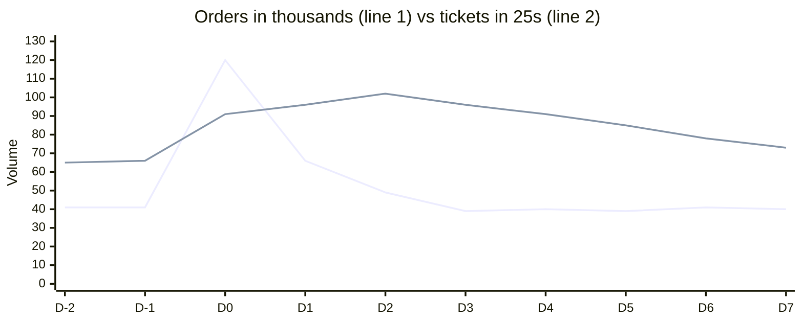
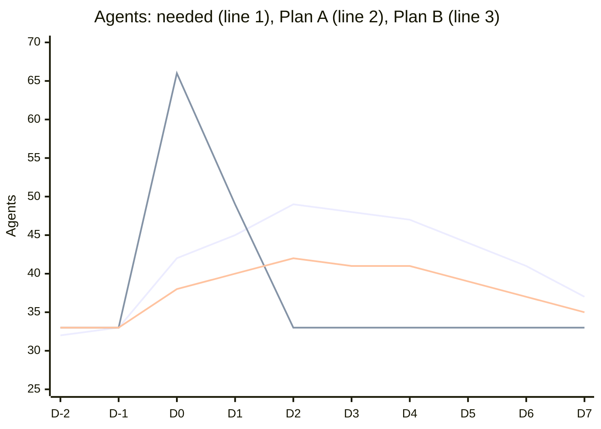

# Sale-Week Support Demand: Where Should the Extra Budget Go?

   

**Orders peak on sale day. Support tickets don't.**

> All data is simulated. No company or customer data is used.

## Business problem

Every big sale in Indian e-commerce gets a fixed extra support budget, and it is usually spent on sale day because that is when orders spike. But customers write in when the parcel is late or when they want to return it. The business question: with the same extra budget, which plan leaves fewer customers waiting?

| | |
|---|---|
| **Who asks** | CX head, operations planning, finance |
| **Data used** | Order volume around the sale, tickets per 100 orders by contact reason, when each reason arrives, and handle time |
| **Approach** | Modelled ticket demand by contact reason with realistic delays, converted it into workload, and compared two plans with exactly the same extra spend |

## Recommendation

1. Spread the extra people across the 5 to 7 days after the sale, peaking on Day 2, instead of doubling the team on sale day. Same budget, about 45% less backlog.
2. Track tickets per 100 orders daily during the sale. If it climbs faster than normal, something broke upstream (a courier or payment gateway) and needs action within hours.


<sub>Tickets are shown in 25s so both fit on one chart. Real numbers are in the table below.</sub>

## Analysis

Orders jump to 3x on sale day and settle over two days. Each order can turn into a ticket later, and the reason decides when:

| Contact reason | Tickets per 100 orders | When it arrives | AHT |
|---|---:|---|---:|
| Payment / coupon | 0.8 | Same day, mostly | 4 min |
| Where is my order | 2.2 | Day 1 to 5, peak on Day 2 | 5 min |
| Returns / refunds | 1.1 | Day 3 to 7 | 8 min |

Workload is turned into agents at 30% shrinkage and 85% occupancy. Then two plans get the **same number of extra agent-days**:

- **Plan A, staff the sale day:** double the team on Day 0, +50% on Day 1, back to normal after.
- **Plan B, staff the wave:** spread the same extra people across the days the tickets actually land.

## Findings

| Day | Orders | Tickets | Agents needed | Plan A | Plan B | Backlog A (hrs) | Backlog B (hrs) |
|---|---:|---:|---:|---:|---:|---:|---:|
| -2 | 41,055 | 1,630 | 32 | 33 | 33 | 0 | 0 |
| -1 | 40,933 | 1,639 | 33 | 33 | 33 | 0 | 0 |
| 0 | 120,238 | 2,280 | 42 | 66 | 38 | 0 | 16 |
| 1 | 66,164 | 2,393 | 45 | 49 | 40 | 0 | 37 |
| 2 | 48,673 | 2,552 | 49 | 33 | 42 | 73 | 67 |
| 3 | 38,969 | 2,397 | 48 | 33 | 41 | 140 | 96 |
| 4 | 40,443 | 2,268 | 47 | 33 | 41 | 202 | 119 |
| 5 | 38,849 | 2,120 | 44 | 33 | 39 | 254 | 143 |
| 6 | 41,054 | 1,960 | 41 | 33 | 37 | 291 | 161 |
| 7 | 39,940 | 1,814 | 37 | 33 | 35 | 310 | 170 |



- **The ticket peak is on Day 2, not sale day.** Sale day brings about 2,300 tickets. Day 2 brings about 2,550, mostly "where is my order".
- **Plan A wastes its extra people.** On sale day it has 66 agents for work that needs 42. By Day 2 it is back to 33 against a need of 49.
- **Same budget, about 45% less backlog.** Plan A ends the week 310 hours behind. Plan B ends 170 hours behind, with exactly the same extra agent-days.
- **Tickets per 100 orders is the early warning.** It sits near 4 on normal days and climbs past 6 by Day 3. If it jumps faster than this, something broke upstream (a courier, a payment gateway), and that's a call to make in hours, not days.

Neither plan clears the queue on its own, which is the honest point: a sale needs a few extra people for a week, not a lot of extra people for one day.

## Run it

```bash
pip install -r requirements.txt
python sale_week_wave.py
```

Writes `outputs/sale_week_plan.csv`, `outputs/summary.csv` and a chart `outputs/sale_week_wave.png`. Change the rates, lags or uplift at the top of the script to match your own business.

## About me

I'm Rahul, a Business Analyst in operations and CX analytics, based in Gurugram (currently at Shiprocket, before that DTDC Express). I build these small case studies on made-up data to practise the kind of business questions I work on, so nothing confidential leaves work. Feedback is welcome.

[LinkedIn](https://www.linkedin.com/in/rahul-219543159/) · [GitHub profile](https://github.com/mail4rahulwork-sketch)

**Other case studies**
- [Why did service level collapse in the festive peak? (Power BI)](https://github.com/mail4rahulwork-sketch/service-performance-powerbi-analysis)
- [Peak-season hiring plan: when to hire, and how many?](https://github.com/mail4rahulwork-sketch/peak-season-hiring-plan-analysis)
- [SLA early-warning rules: is acting early worth the cost?](https://github.com/mail4rahulwork-sketch/sla-early-warning-analysis)
- [Demand forecast to staffing cost: how much can we save?](https://github.com/mail4rahulwork-sketch/demand-forecast-staffing-cost-analysis)
