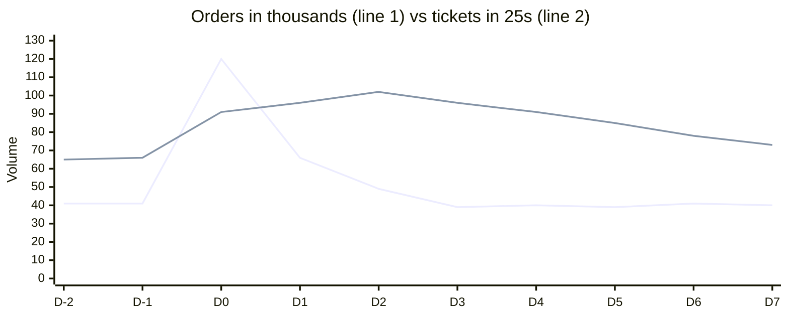
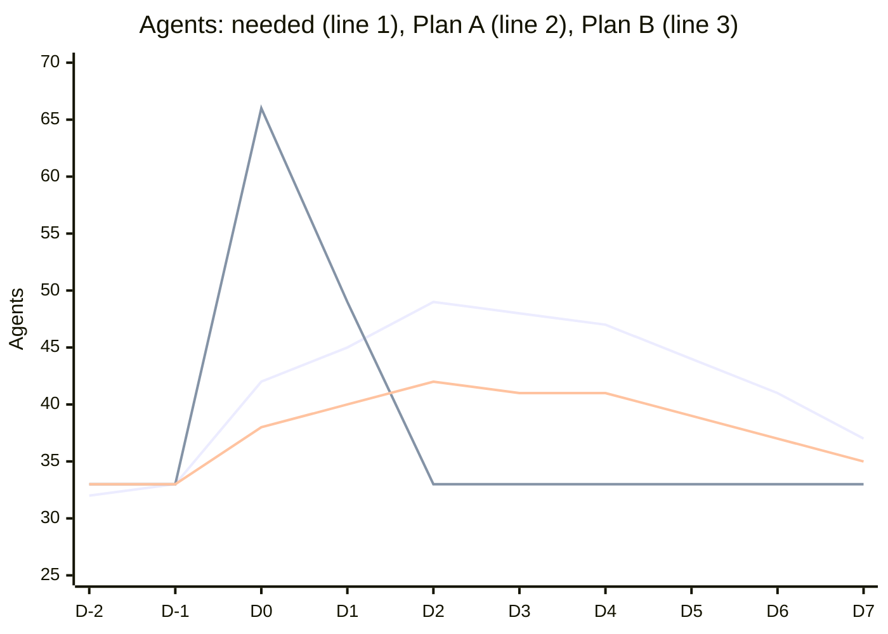

# Sale-Week Ticket Wave

   

**Orders peak on sale day. Support tickets don't.**

Every big sale in Indian e-commerce (Black Friday, festive sales, end of season) gets planned around the order spike. But customers don't write in on the day they order. They write in when the parcel is late, and again when they want to return it. This small simulator shows how that changes the staffing plan.

> All data is simulated. No company or customer data is used.


<sub>Tickets are shown in 25s so both fit on one chart. Real numbers are in the table below.</sub>

## How it works

Orders jump to 3x on sale day and settle over two days. Each order can turn into a ticket later, and the reason decides when:

| Contact reason | Tickets per 100 orders | When it arrives | AHT |
|---|---:|---|---:|
| Payment / coupon | 0.8 | Same day, mostly | 4 min |
| Where is my order | 2.2 | Day 1 to 5, peak on Day 2 | 5 min |
| Returns / refunds | 1.1 | Day 3 to 7 | 8 min |

Workload is turned into agents at 30% shrinkage and 85% occupancy. Then two plans get the **same number of extra agent-days**:

- **Plan A, staff the sale day:** double the team on Day 0, +50% on Day 1, back to normal after.
- **Plan B, staff the wave:** spread the same extra people across the days the tickets actually land.

## What it shows

| Day | Orders | Tickets | Agents needed | Plan A | Plan B | Backlog A (hrs) | Backlog B (hrs) |
|---|---:|---:|---:|---:|---:|---:|---:|
| -2 | 41,055 | 1,630 | 32 | 33 | 33 | 0 | 0 |
| -1 | 40,933 | 1,639 | 33 | 33 | 33 | 0 | 0 |
| 0 | 120,238 | 2,280 | 42 | 66 | 38 | 0 | 16 |
| 1 | 66,164 | 2,393 | 45 | 49 | 40 | 0 | 37 |
| 2 | 48,673 | 2,552 | 49 | 33 | 42 | 73 | 67 |
| 3 | 38,969 | 2,397 | 48 | 33 | 41 | 140 | 96 |
| 4 | 40,443 | 2,268 | 47 | 33 | 41 | 202 | 119 |
| 5 | 38,849 | 2,120 | 44 | 33 | 39 | 254 | 143 |
| 6 | 41,054 | 1,960 | 41 | 33 | 37 | 291 | 161 |
| 7 | 39,940 | 1,814 | 37 | 33 | 35 | 310 | 170 |



- **The ticket peak is on Day 2, not sale day.** Sale day brings about 2,300 tickets. Day 2 brings about 2,550, mostly "where is my order".
- **Plan A wastes its extra people.** On sale day it has 66 agents for work that needs 42. By Day 2 it is back to 33 against a need of 49.
- **Same budget, about 45% less backlog.** Plan A ends the week 310 hours behind. Plan B ends 170 hours behind, with exactly the same extra agent-days.
- **Tickets per 100 orders is the early warning.** It sits near 4 on normal days and climbs past 6 by Day 3. If it jumps faster than this, something broke upstream (a courier, a payment gateway), and that's a call to make in hours, not days.

Neither plan clears the queue on its own, which is the honest point: a sale needs a few extra people for a week, not a lot of extra people for one day.

## Run it

```bash
pip install -r requirements.txt
python sale_week_wave.py
```

Writes `outputs/sale_week_plan.csv`, `outputs/summary.csv` and a chart `outputs/sale_week_wave.png`. Change the rates, lags or uplift at the top of the script to match your own business.

## Skills shown

Demand forecasting by contact reason · Lagged demand · Workload to FTE · Shrinkage and occupancy · Scenario comparison · Python (pandas, matplotlib)

---

## About me

I'm Rahul, a Control Tower – WFM Analyst in Gurugram. I build these small projects to work through the planning problems I see on the job, using made-up data so nothing confidential leaves work.

[LinkedIn](https://www.linkedin.com/in/rahul-219543159/) · [GitHub profile](https://github.com/mail4rahulwork-sketch)

**Other projects**
- [Contact Centre WFM Dashboard (Power BI, live demo)](https://github.com/mail4rahulwork-sketch/powerbi-contact-centre-wfm-dashboard)
- [WFM Forecast to Erlang C Staffing](https://github.com/mail4rahulwork-sketch/wfm-forecast-erlang-staffing)
- [Intraday RTA Early Warning](https://github.com/mail4rahulwork-sketch/intraday-rta-early-warning)
- [Headcount Capacity Plan](https://github.com/mail4rahulwork-sketch/contact-centre-headcount-capacity-plan)
